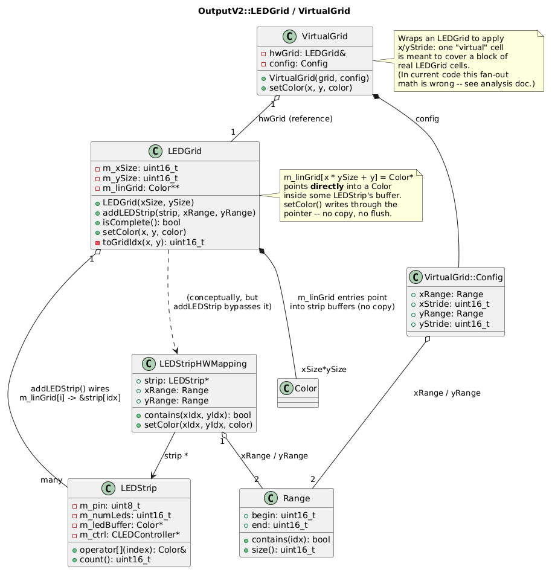
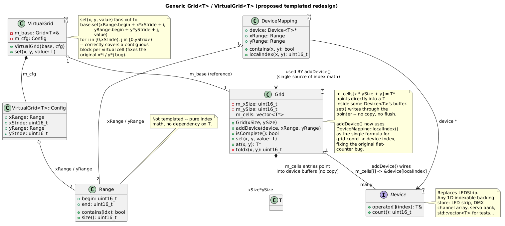

# LEDGrid / VirtualGrid

Analysis of the `OutputV2::LEDGrid` / `OutputV2::VirtualGrid` prototype (`src_prev/OutputV2/LEDGrid.h`, `VirtualGrid.h`) and a proposed generic redesign.

This code is unfinished scratch/prototype work living in `src_prev` — it is not currently wired into the active engine. Two other files in the same tree (`CoreV2/Grid.h` + `LEDStripMapping`) explore a second, closure-based take on the same idea; they aren't covered in detail here.

## 1. As-is design

Diagram: [`led_grid.puml`](led_grid.puml) / 

### The virtual grid idea

The goal is to let effect/fixture code address LEDs by 2D `(x, y)` coordinates even though the real hardware is one or more independent `LEDStrip`s wired up in arbitrary physical layouts (e.g. a panel built from several strips tiled side by side). `LEDGrid` builds a lookup table of pointers directly into the strips' pixel buffers, so a 2D coordinate resolves to a live memory location — writes land straight in the buffer FastLED reads from, no copy or flush step needed.

### Classes

- **`Range { begin, end }`** — a half-open interval, reused for both x-spans and y-spans.
- **`LEDStrip`** — the hardware layer: a flat `Color` buffer tied to a pin/protocol via FastLED. Addressed only by a flat strip index; has no notion of 2D layout.
- **`LEDStripHWMapping`** — describes one strip's placement: a `LEDStrip*` plus the `xRange`/`yRange` rectangle it occupies on the grid, with the math to convert a grid coordinate into that strip's local index.
- **`LEDGrid`** — owns `Color** m_linGrid`, sized `xSize * ySize`. Each slot is a pointer into some strip's buffer, not pixel data itself. `addLEDStrip()` wires up a rectangular region of the grid to a given strip; `setColor(x, y, color)` resolves `x * ySize + y` and writes through the pointer; `isComplete()` checks every cell got wired.
- **`VirtualGrid`** — wraps an `LEDGrid&` plus a `Config { xRange, xStride, yRange, yStride }`, meant to let a coarser logical grid address blocks of real cells (e.g. treat a 2×2 block as one "virtual" pixel for chunkier effects).

### Known bugs in the current code

- `LEDGrid::addLEDStrip` never actually calls into `LEDStripHWMapping`. It recomputes the index itself with a flat counter `idx` that is **pre-incremented before first use**, so slot 0 is never written, and the counter isn't derived from `(x, y)` at all — so for anything but the simplest single-strip case, pixels land in the wrong cells.
- `LEDGrid`'s `m_linGrid` is allocated with `new Color*[...]`, which does not zero-initialize the array, so `isComplete()`'s null checks rely on garbage pointers until this is fixed.
- `VirtualGrid::setColor` computes `hwX = xRange.begin + x * i` (multiplying the coordinate by the loop index) instead of offsetting it (`x * xStride + i`), so it doesn't correctly cover a contiguous stride block per virtual cell.
- `LEDGrid.cpp` is empty and nothing outside this prototype references `LEDGrid`/`VirtualGrid` — this looks like an abandoned in-progress rewrite, consistent with sitting in `src_prev` next to `LEDGridOld.h`.

## 2. Proposed generic redesign

Diagram: [`led_grid_generic.puml`](led_grid_generic.puml) / 

The as-is design hardcodes `Color` as the cell type, but nothing about the addressing/composition logic actually depends on it — genericizing over `typename T` makes the same grid machinery reusable for DMX channel arrays, servo targets, or anything else addressable in 2D, and fixes the bugs above by construction (a single formula for index math instead of two independent, diverging implementations).

### Classes

- **`Range`** — unchanged, stays non-templated; pure index math with no dependency on `T`.
- **`Device<T>`** *(replaces `LEDStrip`)* — an abstract interface (`operator -> T&`, `count()`), so `Grid<T>` can back onto any indexable 1D store: a real LED strip, a plain `std::vector<T>` for tests, a DMX channel array, etc.
- **`DeviceMapping<T>`** *(replaces `LEDStripHWMapping`)* — a `Device<T>*` plus its `xRange`/`yRange`, with `localIndex(x, y)` as the **single** formula for grid-coordinate → device-local-index. `Grid<T>::addDevice` uses this directly instead of recomputing its own counter, closing the original indexing bug.
- **`Grid<T>`** *(replaces `LEDGrid`)* — owns `std::vector<T*> m_cells`. `addDevice(device, xRange, yRange)` wires a region via `DeviceMapping<T>::localIndex`; `set(x, y, value)` writes through the stored pointer; `at(x, y)` reads it back; `isComplete()` checks for unwired cells.
- **`VirtualGrid<T>`** *(replaces `VirtualGrid`)* — wraps a `Grid<T>&` plus a stride `Config`. `set(x, y, value)` now correctly computes `xRange.begin + x*xStride + i` (and the `y` equivalent) so each virtual cell fans out to a contiguous `xStride × yStride` block of the base grid.

### What changes vs. what's preserved

| Concern | As-is | Generic |
|---|---|---|
| Cell payload | `Color` only | any `T` |
| Backing device | concrete `LEDStrip` | `Device<T>` interface |
| Grid-coord → device-index | duplicated, buggy, in two places | one formula in `DeviceMapping<T>::localIndex` |
| Stride fan-out | wrong offset math | corrected `x*stride + i` |
| Write mechanism | pointer indirection, write-through | unchanged — same zero-copy pointer table, just typed generically |

`T` only needs to support `operator=` (copy-assignable) for `Grid<T>::set` to work — no other constraints, so it's a drop-in replacement for the `Color`-specific version wherever the addressing/composition logic is reused for a different payload type.
