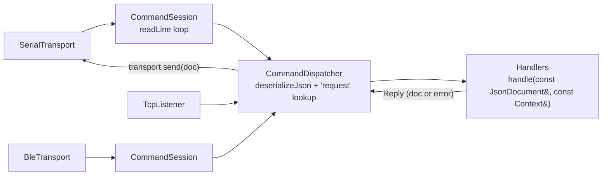
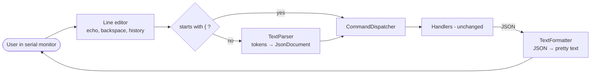
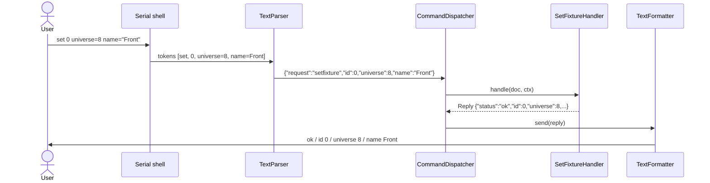
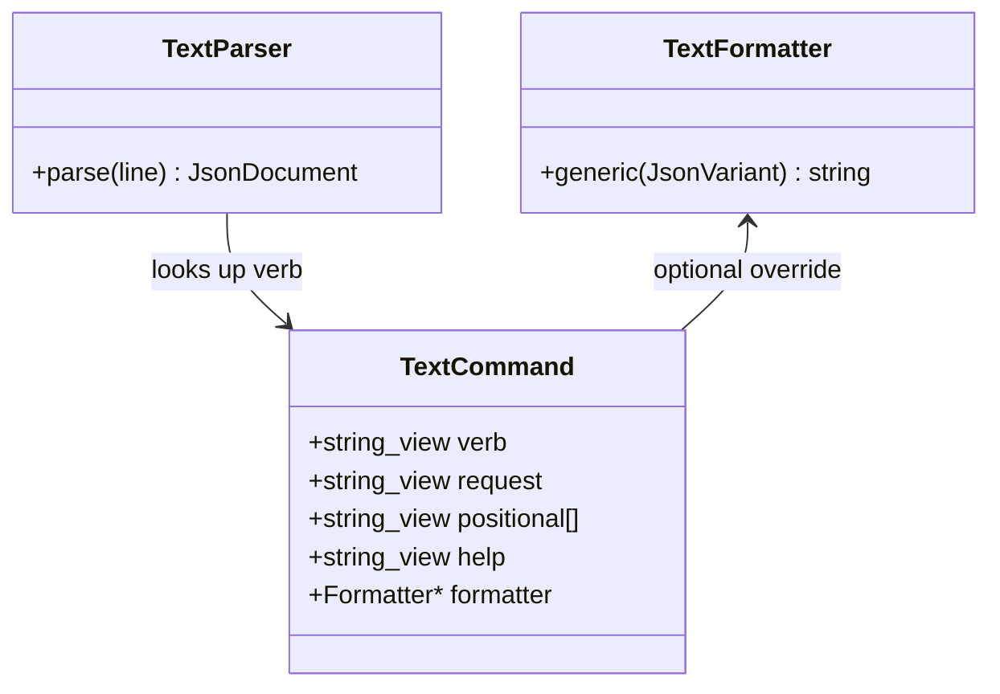
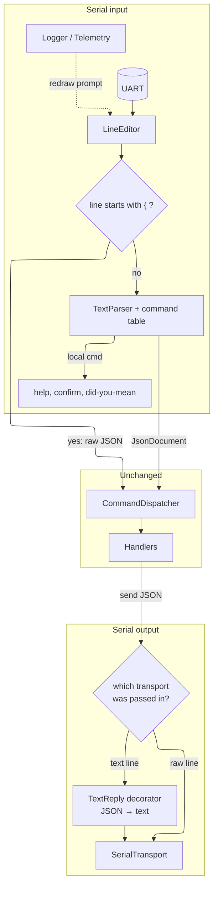

# Serial text shell (design)

Human-friendly commands over serial, translated into the existing JSON
commands. Handlers and TCP stay unchanged; lines starting with `{` are still
treated as raw JSON. Rendered PNGs: `serial_shell-N.png` (regenerate with
`mmdc -i serial_shell.md -o serial_shell.png -b white -s 2`).

## 1. Current command flow

## 2. Proposed text front-end

## 3. One `set` command, end to end

## 4. Command table

## 5. Where it plugs into the current stack

`SerialShell` replaces `m_serialSession` (`Core/Engine.h`). The shell picks the
reply format by choosing which transport it passes to the dispatcher.

